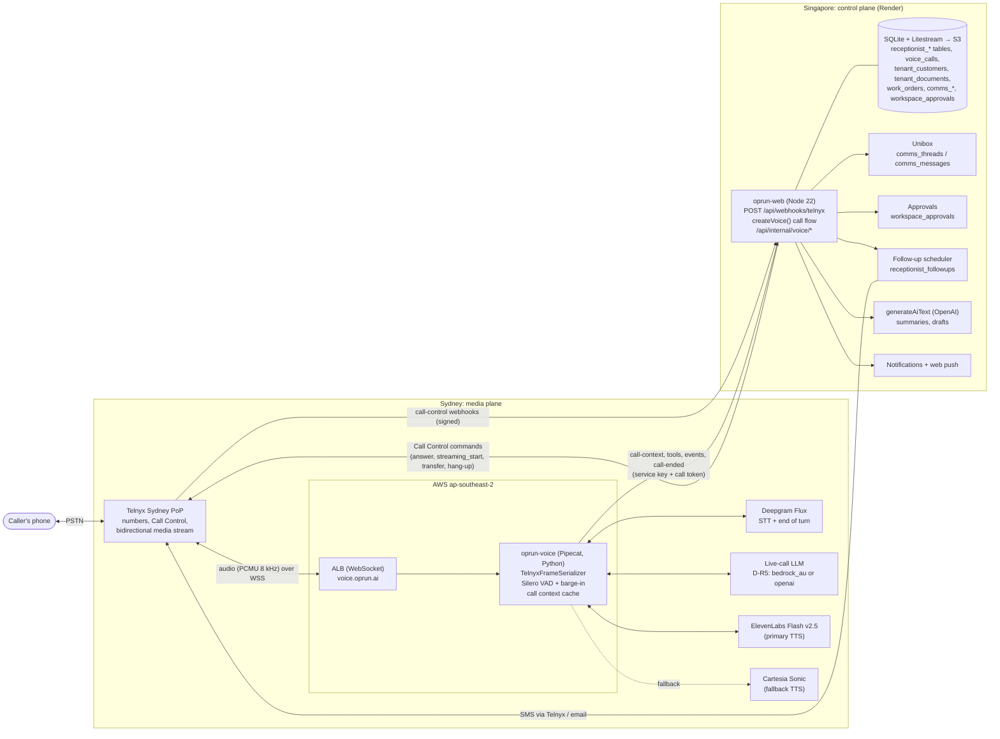
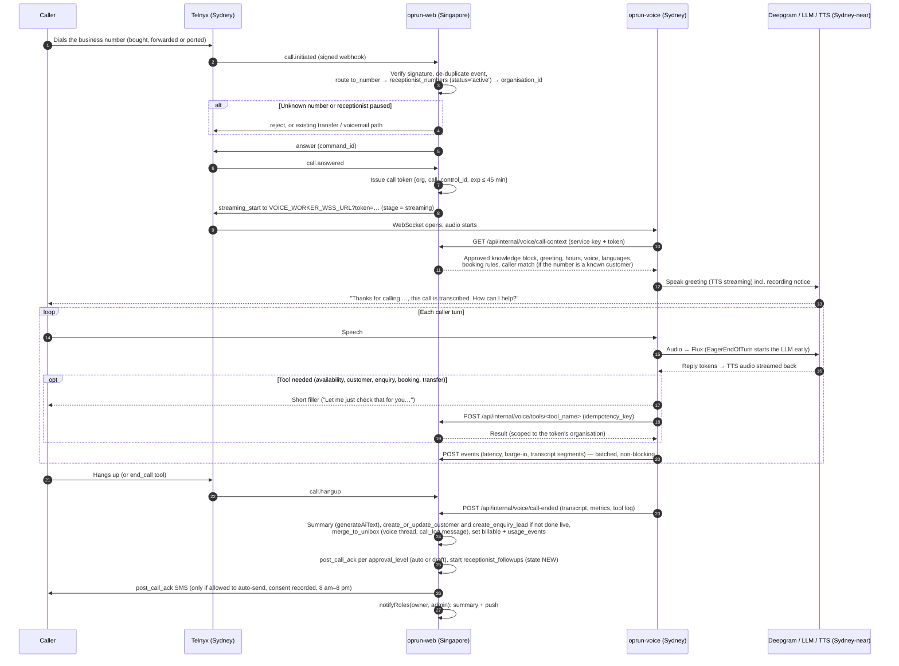
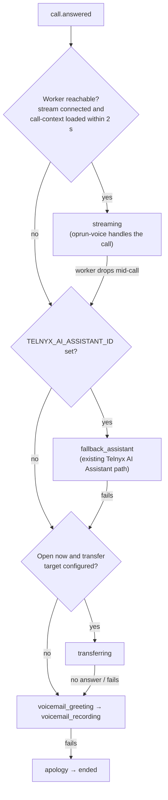

# 01 Architecture

Names, tables, states and decisions follow [00_CONTRACT.md](00_CONTRACT.md). Tool schemas are in
[04_TOOLS.md](04_TOOLS.md), the enquiry and follow-up states in [05_LEAD_TO_BOOKING_FLOW.md](05_LEAD_TO_BOOKING_FLOW.md),
knowledge loading in [07_KNOWLEDGE_AUTOLOAD.md](07_KNOWLEDGE_AUTOLOAD.md), and security and billing in
[08_SECURITY_COMPLIANCE_METERING.md](08_SECURITY_COMPLIANCE_METERING.md).

## 1. The idea in one paragraph

The system has two planes. The **media plane** carries the caller's voice. It runs entirely in Sydney: Telnyx's Sydney
point of presence streams the call audio to `oprun-voice` (Pipecat on AWS `ap-southeast-2`). There, Deepgram Flux
hears the caller, the LLM decides the reply, and ElevenLabs (or Cartesia as fallback) speaks it. The **control plane**
is the existing `oprun-web` service on Render in Singapore. It owns the database, the Telnyx call-control webhook,
customers, enquiries, bookings, approvals, the Unibox and the follow-up scheduler. Audio never goes to Singapore. Only
call-control events, one context load at the start of the call, tool calls and the end-of-call report cross between
Sydney and Singapore.

## 2. Component diagram

## 3. One inbound call, end to end

Tool behaviour and schemas are in [04_TOOLS.md](04_TOOLS.md). What happens to the enquiry after the call is in
[05_LEAD_TO_BOOKING_FLOW.md](05_LEAD_TO_BOOKING_FLOW.md).

## 4. Fallback chain (a caller is never left in silence)

The chain reuses the Phase 07 steps in `src/comms/voice.js`. Each failed step is recorded in `voice_calls.failures_json`
and shown on the call in the AI Receptionist section. When the worker drops mid-call, `oprun-web` sees the stream end
without a `call-ended` report while the call is still up, and moves to the next step.

## 5. Latency budget (caller stops speaking → first audio)

| Stage | Budget | Notes |
|---|---|---|
| Telnyx Sydney PoP + PSTN leg to the worker | ~80 ms | Audio stays in Sydney |
| End of turn (Flux) | 200–260 ms | `eot_threshold=0.7`; `eager_eot_threshold=0.5` starts the LLM before the turn is final |
| LLM first tokens | 150–250 ms | Prompt is small: knowledge block cached at call start, no per-turn database reads |
| TTS first audio (ElevenLabs Flash v2.5) | 100–185 ms | Streamed sentence by sentence |
| **Total** | **530–775 ms** | Release gate: p95 ≤ 1000 ms on the Sydney test set |

Barge-in: Silero VAD in the worker stops TTS output within 80 ms of confirmed caller speech and clears the Telnyx
playback buffer. Backchannels ("yeah", "uh-huh", "ok", under ~600 ms) do not stop speech. The rules are in
[03_NATURALNESS_PROMPT.md](03_NATURALNESS_PROMPT.md).

## 6. What crosses Sydney ↔ Singapore, and why that is acceptable

| Crossing | When | Effect on the caller |
|---|---|---|
| Telnyx webhooks → `oprun-web`, commands back | Call set-up and hang-up only | Adds well under a second before the greeting; the caller hears ringing, not silence |
| `GET call-context` | Once, at call start | Everything the agent needs (knowledge, hours, booking rules, caller match) is cached in the worker for the whole call |
| `POST tools/*` | Only when a tool is needed | The agent speaks a short filler first, so the ~100 ms round trip plus database work is covered |
| `POST events` | Batched, fire-and-forget | None |
| `POST call-ended` | After the caller has gone | None |

No caller turn waits on Singapore unless a tool is needed, and then a filler covers it.

## 7. Scaling and concurrency

- `oprun-voice` is stateless between calls. Each call is one Pipecat pipeline inside one WebSocket session.
- Start with **20 concurrent calls per Fargate task** (1 vCPU, 2 GB). Pipecat work is mostly I/O; VAD is light. Confirm the
  number with the load test in Phase 0 and lower it if p95 latency rises.
- Minimum **2 tasks** in different availability zones. Autoscale on active sessions per task (target 70 % of the limit)
  and CPU (target 60 %). Scale-in waits for active calls to finish (connection draining up to 30 minutes).
- A task that is full refuses new WebSockets, the ALB tries another task, and if none can take the call the fallback
  chain in §4 handles it.
- Vendor concurrency limits (Deepgram, ElevenLabs, Cartesia plans) must be at least the planned peak; the worker reports
  vendor 429 errors as events so the founder can see them.

## 8. Failure modes

| Failure | Detection | Handling |
|---|---|---|
| Worker unreachable at answer | No stream or no `call-context` within 2 s | Fallback chain §4 |
| Worker drops mid-call | Stream ends, call still up, no `call-ended` | `fallback_assistant`, then transfer or voicemail |
| Deepgram error | STT socket error | Reconnect once; if it fails, agent says it will take a message and uses `take_message` via the fallback path |
| ElevenLabs error or slow first audio (> 600 ms) | TTS error or timeout | Switch to Cartesia for the rest of the call |
| LLM error or timeout (> 2 s) | Provider error | Retry once with a shorter prompt; else filler + `take_message` |
| Tool call fails | Non-2xx from `oprun-web` | Agent never claims success; it says the team will confirm and records the request in the call report |
| Singapore unreachable mid-call | Tool and event calls fail | Agent keeps talking from cached context and takes a message; the worker keeps the transcript and retries `call-ended` with the same idempotency key |
| Duplicate webhook / retried tool call | `voice_events`, `idempotency_key` | Ignored |
| Spend cap reached | Checked in `call-context` | Behaviour set by the owner; see [08](08_SECURITY_COMPLIANCE_METERING.md) |

## 9. Telnyx media streaming parameters

`streaming_start` is called by `oprun-web` with the worker URL and the call token, bidirectional RTP audio in PCMU at
8 kHz. The parameter names (`stream_url`, `stream_track`, `stream_bidirectional_mode`, `stream_bidirectional_codec`)
follow Telnyx's documentation but **have not been sent to the live API. Verify on staging before relying on them.**
The same applies to clearing the playback buffer on barge-in. Pipecat's `TelnyxFrameSerializer` handles the stream
format on the worker side.

## 10. Observability

Per call, stored on `voice_calls` and shown in the AI Receptionist section:
- `latency_p50_ms`, `latency_p95_ms` (caller stops → first audio, every turn).
- `barge_in_count` and, in the events log, each barge-in's stop time (target ≤ 80 ms).
- TTS provider used, fallback switches, tool calls with durations and results, `failures_json`.

Platform-wide (Founder Console): p50/p95 by day, calls by outcome, fallback rate, vendor errors, active sessions per
task. Alert the founder when p95 > 1000 ms for an hour or the fallback rate passes 5 %.
Transcripts in logs are redacted; full transcripts live only in the database under the retention rules in
[08](08_SECURITY_COMPLIANCE_METERING.md).
