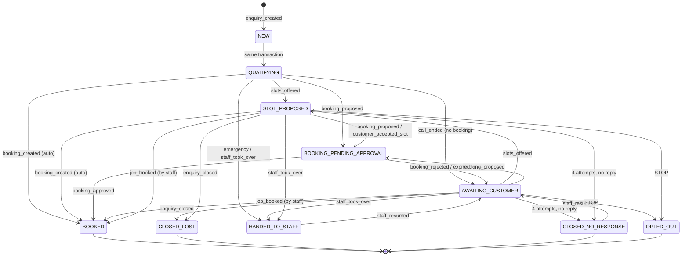

# 05 Enquiry → Lead → Unibox → Follow-up until confirmed booking

Output #5. The exact follow-up state machine (`receptionist_followups.state`, contract §6.1), when messages are drafts
or sent automatically (contract §8), how approvals are respected (contract §7), the cadence (contract §9), the
scheduler and the Unibox behaviour. Tool behaviour is in `04`, customer rules in `06`.

## 1. The path in one view

1. **Call** → `create_or_update_customer` (customer, `status='lead'` if new) → `create_enquiry_lead` (enquiry
   `tenant_documents kind='enquiry' channel='receptionist'`, follow-up row `QUALIFYING`).
2. **Booking in the call** (optional) → `check_availability` → `SLOT_PROPOSED` → `propose_booking` →
   `BOOKING_PENDING_APPROVAL` (or `BOOKED` when `booking_mode='auto'`).
3. **Hang-up** → `merge_to_unibox` writes the one call-log entry to the caller's `voice` thread and links customer
   and enquiry → owner push + internal SMS summary → follow-up event `call_ended`.
4. **After the call** → the follow-up machine sends or drafts messages at the cadence until `BOOKED` or a closed
   state.

## 2. States

| State | Meaning | Automatic messages? |
|---|---|---|
| `NEW` | Row created, call still running | No |
| `QUALIFYING` | The receptionist is collecting the need in the call | No |
| `AWAITING_CUSTOMER` | We are waiting for the customer to choose a time or answer | Yes, at the cadence |
| `SLOT_PROPOSED` | Times were offered (in the call or in a message) and the customer has not picked one | Yes, at the cadence |
| `BOOKING_PENDING_APPROVAL` | A time is held and a `receptionist_booking` approval is waiting | No nudges to the customer |
| `BOOKED` | A booking and job exist (terminal) | Only `booking_confirmation` |
| `CLOSED_LOST` | Staff closed the enquiry, or the customer declined (terminal) | No |
| `CLOSED_NO_RESPONSE` | Cadence finished with no reply (terminal) | No |
| `OPTED_OUT` | Customer replied STOP or unsubscribed (terminal) | No |
| `HANDED_TO_STAFF` | A person owns it; automation is paused | No (staff can resume) |

`NEW` exists so the row is visible while the call is live; `create_enquiry_lead` moves it to `QUALIFYING` in the
same transaction, so a row is normally never seen in `NEW` after the call.

## 3. Transition table

Every transition is one SQLite transaction guarded by `WHERE id=? AND organisation_id=? AND state=<from>`; zero rows
changed means another worker already moved it, and the event is dropped (idempotent).

| # | From | Event | Guard | To | Side effects |
|---|---|---|---|---|---|
| 1 | — | `enquiry_created` (tool `create_enquiry_lead`) | no row for this `enquiry_id` | `NEW` → `QUALIFYING` | Insert row, `step=0`, `attempts=0` |
| 2 | `QUALIFYING`, `AWAITING_CUSTOMER` | `slots_offered` (`check_availability` returned slots in a call, or a message offering times was sent) | ≥1 slot | `SLOT_PROPOSED` | No hold and no new column: times offered in a call stay in `voice_calls.summary_json.offered_slots`; times offered by message are in that outbound message's body (row 13 reads them from there) |
| 3 | `QUALIFYING`, `SLOT_PROPOSED`, `AWAITING_CUSTOMER` | `booking_proposed` (`propose_booking`, `booking_mode='approve'`) | hold created | `BOOKING_PENDING_APPROVAL` | Approval `receptionist_booking` exists; cadence stopped (`next_action_at=NULL`) |
| 4 | `QUALIFYING`, `SLOT_PROPOSED`, `AWAITING_CUSTOMER` | `booking_created` (`propose_booking` with `booking_mode='auto'`) | booking created | `BOOKED` | Queue `booking_confirmation` (§5) |
| 5 | `QUALIFYING`, `SLOT_PROPOSED` | `call_ended` | no booking, urgency not emergency | `AWAITING_CUSTOMER` (from `QUALIFYING`) / stays `SLOT_PROPOSED` | Queue attempt 1 `post_call_ack` (§4) |
| 6 | `BOOKING_PENDING_APPROVAL` | `call_ended` | — | same | Queue attempt 1 `post_call_ack` ("we'll confirm your time shortly") |
| 7 | any non-terminal | `call_ended` | urgency `emergency` | `HANDED_TO_STAFF` | Urgent push already sent by the tool; no automatic messages |
| 8 | `BOOKING_PENDING_APPROVAL` | `booking_approved` (approval decision) | `createBookingFromEnquiry` succeeded | `BOOKED` | Delete hold; queue `booking_confirmation` |
| 9 | `BOOKING_PENDING_APPROVAL` | `booking_rejected` or approval `expired` | — | `AWAITING_CUSTOMER` | Delete hold; create a `free_text_reply` **draft** offering new times (always needs approval); notify the approver's team that the customer must be told |
| 10 | `AWAITING_CUSTOMER`, `SLOT_PROPOSED` | `followup_due` (scheduler) | `attempts < 4`, not paused | same | Send/draft attempt `attempts+1` (§4); `attempts++`; set `next_action_at` for the next attempt |
| 11 | `AWAITING_CUSTOMER`, `SLOT_PROPOSED` | `followup_due` | `attempts = 4` and no reply since attempt 4 | `CLOSED_NO_RESPONSE` | The enquiry itself stays `open` so staff decide whether to close it; the thread gets a note "No reply after 4 follow-ups" |
| 12 | non-terminal except `HANDED_TO_STAFF` | `customer_replied` (inbound message on a linked thread) | message is not STOP | same (`SLOT_PROPOSED` if a time was offered) | Pause cadence (`next_action_at=NULL`); thread is `needs_reply` (existing `recordInbound` behaviour); draft a `free_text_reply` (§6) |
| 13 | `SLOT_PROPOSED` | `customer_accepted_slot` (reply clearly picks one of the offered times; parser confidence ≥ 0.9) | slot still free | `BOOKING_PENDING_APPROVAL` (or `BOOKED` if `auto`) | Same as rows 3/4, created by the system actor; anything less certain stays row 12 |
| 14 | any non-terminal | `opted_out` (STOP / unsubscribe, existing `suppress()` in `onInbound`) | — | `OPTED_OUT` | Cancel queued messages for this enquiry (schedule rows → `cancelled`, pending approvals → `cancelled`) |
| 15 | any non-terminal | `staff_took_over` (a person sends a manual reply on a linked thread, or presses "I'll handle it") | — | `HANDED_TO_STAFF` | Cancel queued automatic messages; drafts stay for the person to use or discard |
| 16 | `HANDED_TO_STAFF`, `CLOSED_NO_RESPONSE` | `staff_resumed` | not opted out | `AWAITING_CUSTOMER` | `attempts` reset to the next unused attempt; schedule it |
| 17 | any non-terminal | `enquiry_closed` (existing `POST /api/saas/pipeline/enquiries/:id/close`) | — | `CLOSED_LOST` | Cancel queued messages |
| 18 | any non-terminal | `job_booked` (existing event `job.booked` whose booking `source_id` chain leads to this enquiry, e.g. booked through a quote by staff) | payload `via` ≠ `'receptionist'` (the receptionist's own bookings are handled by rows 4 and 8) | `BOOKED` | Cancel queued nudges; **no** automatic confirmation (staff booked it themselves) |

Events 17 and 18 come from existing routes: the close route and `events.emit(org, 'job.booked', …)` in
`src/pipeline.js`. The follow-up module subscribes to the existing event emitter; the routes are not changed.

## 4. Messages per attempt (cadence from contract §9)

| Attempt | When | Class | Content (template) |
|---|---|---|---|
| 1 | Within 5 min after hang-up | `post_call_ack` | "Hi <first name>, thanks for calling <business>. We've got your request for <service> and will be in touch about a time. Reply STOP to opt out." Booking pending: "…we've pencilled in <slot label> and will confirm shortly." |
| 2 | +4 h, business hours only | `followup_nudge` | Up to 2 open times from `check_availability`, or "When suits you?" |
| 3 | Next business day 10 am | `followup_nudge` | Same, fresh times |
| 4 | +3 business days | `followup_nudge` | "Still keen? Reply with a time that suits, or we'll close this off." |
| — | After booking | `booking_confirmation` | "<first name>, you're booked for <service> on <slot label> at <address>. Reply here if anything changes." |

Rules:
- Attempts 2–4 that include times are created from a fresh `check_availability` run at send time; no holds are made
  for times offered by message (the hold happens when the customer accepts, row 13).
- Quiet hours 8 pm – 8 am in `receptionist_config.timezone`: `send_at` moves to 8 am (attempt 2 and 3 to the next
  business-hours opening).
- No consent or a suppression on the channel → the attempt is skipped and the thread gets a note "Could not follow
  up: no consent to text/email". The state still advances by time so the enquiry does not hang forever.
- Channel order: SMS if the customer gave SMS consent, else email, else none.

## 5. Draft or auto-send (contract §8 decides)

The class of each message decides; `receptionist_config.approval_level` is read **at send time**, so changing the
setting affects messages not yet created. For each message the module calls the same internal path as the
`draft_followup` tool (`04` §3.9):
- auto → `comms_messages.status='approved'` + `comms_message_schedule` row; the existing `sendDue()` sends it.
- draft → `status='pending_approval'` + `workspace_approvals` (`approval_type='outbound_message'`,
  `source_module='receptionist'`) + schedule row. The existing approval route and `applyApprovalToComms()` flip it to
  `approved`; `sendDue()` sends it when due. A rejected draft is cancelled by `sendDue()` (existing behaviour) and the
  follow-up stays in its state; the next attempt is still created at its time.
- A draft whose approval is still pending when the next attempt is due: the old draft is cancelled (approval →
  `cancelled`) and replaced, so the approver never sees two nudges for one enquiry.

## 6. Customer replies

- Inbound SMS/email arrives through the existing `recordInbound()` → `onInbound()` (analysis, STOP handling). A new
  inbound hook (registered in the existing `inboundHooks` set, `src/saas-platform.js`) finds the follow-up through
  `comms_thread_meta.enquiry_id` and fires `customer_replied`, `opted_out` or `customer_accepted_slot`.
- The reply draft is a `free_text_reply`: written by the existing `generateAiText` path with the enquiry, the offered
  times and approved knowledge only (`07`); always needs approval (contract §8). It appears in the Unibox thread as
  an AI draft (`ai_generated=1`, `status='pending_approval'`), exactly like today's AI replies.
- Parsing "yes, Tuesday 9 works" into row 13 uses the LLM with a strict JSON answer `{ choice: <offered slot index> |
  null, confidence }`; below 0.9 or null → row 12 only.

## 7. Unibox behaviour

| Thread | Created by | Linked how | Status rules |
|---|---|---|---|
| `voice` thread for the caller's number (one per business + number, existing UNIQUE) | `merge_to_unibox` via `recordInbound` | `comms.link(…, { customer_id, enquiry_id })` → `comms_thread_meta` | `recordInbound` sets `needs_reply`. If the follow-up is `BOOKED` or `BOOKING_PENDING_APPROVAL` at call end, the module sets the voice thread `open` (nothing to reply to; the approval is the action) |
| `sms` / `email` thread for the customer | first follow-up message (§5) | same `customer_id` + `enquiry_id` in `comms_thread_meta` | Outbound only → `open`; a customer reply → `needs_reply` (existing) |

The Unibox "Enquiries" view (existing `VIEWS` includes `enquiries`) shows these threads because `enquiry_id` is set.
The enquiry's own page shows the follow-up state and the next scheduled action (UI in `02`).

## 8. Scheduler

- Runs inside `oprun-web` on the existing durable queue (`src/job-queue.js`, instance `jobQueue` in `src/server.js`).
- New job type `receptionist.followup` (registered with `jobQueue.register`). Each scheduled action is enqueued with
  `runAt = next_action_at` and `idempotencyKey = 'rxf:' + followup_id + ':' + attempt`. The queue's unique
  idempotency key means a double enqueue is ignored.
- The handler re-reads the row and acts only if `state` and `attempts` still match the job payload; otherwise it
  returns without doing anything (a reply, takeover or booking happened in between).
- Safety sweep every 5 minutes (same pattern as the existing 30-second `sendDue` interval): rows with
  `next_action_at <= now` and no queued job get one. This recovers jobs lost in a crash before enqueue.
- Approval expiry: the same sweep finds `receptionist_booking` approvals past `expires_at` still `pending`, marks
  them `expired` (like the decision route does) and fires row 9.

## 9. Events and notifications

| When | What | Who |
|---|---|---|
| Enquiry created | existing `events.emit(org, 'enquiry.created', …)` from `createEnquiry` | automations |
| Emergency in a call | urgent push `receptionist_emergency` | owner, admin |
| Every answered call ends | push "New call: <name> – 
" (`kind:'receptionist_call'`) via `notifications.notifyRoles(org, ['owner','admin'], …)` | owner, admin |
| Every answered call ends | **Internal** SMS summary to each owner/admin whose `notification_preferences.sms = 1` and who has a mobile on their user profile, sent through Telnyx with `TELNYX_MESSAGING_PROFILE_ID`. It is a staff notification, not a customer message, so §8 and the customer cadence do not apply | owner, admin |
| Booking waiting for approval | push "Booking to approve: <service>, <slot label>" | approvers |
| Booking approved | existing `job.booked` event | automations |
| Follow-up closed with no response | in-app notification only | owner |

## 10. State diagram

(`OPTED_OUT`, `CLOSED_LOST`, `HANDED_TO_STAFF` and `job_booked` apply from every non-terminal state; only the main
arrows are drawn.)

## 11. Tests that must exist before go-live
1. Each row of §3 has a test; a duplicate event or a stale scheduler job changes nothing.
2. With `approval_level='approve_all'`, no customer message is sent without an approval (messages only reach
   `approved` through the approval route).
3. STOP from the customer cancels every queued message for that enquiry within one scheduler tick.
4. A staff manual reply moves the follow-up to `HANDED_TO_STAFF` and no automatic message follows.
5. Quiet hours: a message due at 9 pm is sent at 8 am in the business time zone.
6. A booking approved after the customer already booked through staff (row 18) does not create a second booking:
   `createBookingFromEnquiry` refuses an enquiry that is no longer `open/draft/quoted`, and the approval decision
   returns 409.
