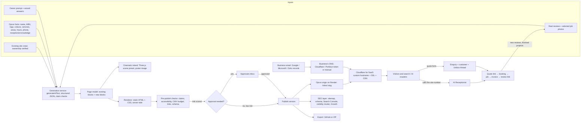

# 02 Architecture

## 1. Flow (prompt to published site to Oprun records)

## 2. Components

| Component | Where | New or existing |
|---|---|---|
| Page model, renderer, checks, approvals | `src/seo/builder.js`, `src/seo/service.js`, automation engine | Existing, extended (new blocks, `style_json`, CWV budget check) |
| Generation service | `src/website/generate.js` | New. Calls `generateAiText` with a JSON schema per block; temperature low; every text block passes `checkClaims` |
| Cinematic islands | `saas/site-runtime/cinematic.js` + scene presets in `saas/site-runtime/scenes/` | New. Three.js bundled locally (no CDN, CSP stays `script-src 'self'`) |
| Transfer crawler | Existing `crawlSite` in `src/seo/audit.js` | Existing, reused with ownership gate and redirect mapper `src/website/transfer.js` |
| Domains | `src/website/domains.js` (Cloudflare for SaaS custom hostnames API) | New |
| DNS connections | `src/website/dns.js` (Cloudflare DNS API, Porkbun API v3), secrets via `integrationRuntime.encryptBundle` | New |
| Email set-up | `src/website/email-dns.js` (record templates per provider, DNS-over-HTTPS verification) | New |
| Growth | `src/website/growth.js` (opportunities, outreach drafts, snapshot import) | New; replaces the `backlinks` placeholder |
| Export | `src/website/export.js` (static bundle; GitHub contents/trees API via the business's GitHub connection) | New |
| Host routing | Express: when `Host` is an active `website_domains.hostname`, serve that site at `/` (same renderer as `/sites/:slug`) | New middleware, before the app routes |
| UI | `saas/workspace-website.js` (one section, 7 tabs) | New; existing SEO views are mounted inside tabs, not duplicated |

## 3. Request path for a custom domain

1. Visitor → `https://www.example.com.au/` → Cloudflare for SaaS (custom hostname active, certificate issued by Cloudflare) → origin `https://www.oprun.ai` with the original `Host` header (Cloudflare `custom origin SNI` set to the Oprun host).
2. Oprun's host middleware looks up `website_domains` where `hostname = Host` and `status = 'active'`; unknown hosts get 404 (never another business's site).
3. Static HTML is served with `Cache-Control: public, max-age=300, stale-while-revalidate=86400`; Cloudflare caches it, so Australian visitors do not wait for the Singapore origin.
4. Publishing purges that hostname's cache (Cloudflare API `purge_cache` by host).

## 4. Security

- Separate cookie-less origin for public sites: public site pages set no cookies and read no session.
- CSP on generated sites: `default-src 'self'; img-src 'self' data: https:; script-src 'self'; style-src 'self' 'unsafe-inline'; frame-ancestors 'none'`.
- Business-supplied HTML is never rendered raw; only block fields, escaped.
- DNS and GitHub credentials are encrypted, write-only, scoped to one zone or repo, and removable at any time.
- Host middleware never trusts `X-Forwarded-Host` from outside Cloudflare (allow Cloudflare IP ranges only, or a shared secret header added by a Cloudflare rule).
- Crawler: public HTTPS only, no private IP ranges (existing `publicHost` check), robots.txt honoured, 1 request per second.

## 5. Performance budget (checked before publish, D-W3)

| Metric | Budget |
|---|---|
| HTML per page | ≤ 60 KB compressed |
| CSS | ≤ 30 KB compressed, inlined critical CSS |
| JavaScript without Cinematic | ≤ 10 KB (form helper, visit counter) |
| Cinematic island | ≤ 180 KB JS compressed + ≤ 1.5 MB model/textures; loaded after `load` and only when visible |
| LCP element | Text or poster image, never the WebGL canvas |
| Images | AVIF/WebP, width-set `srcset`, lazy below the fold |
