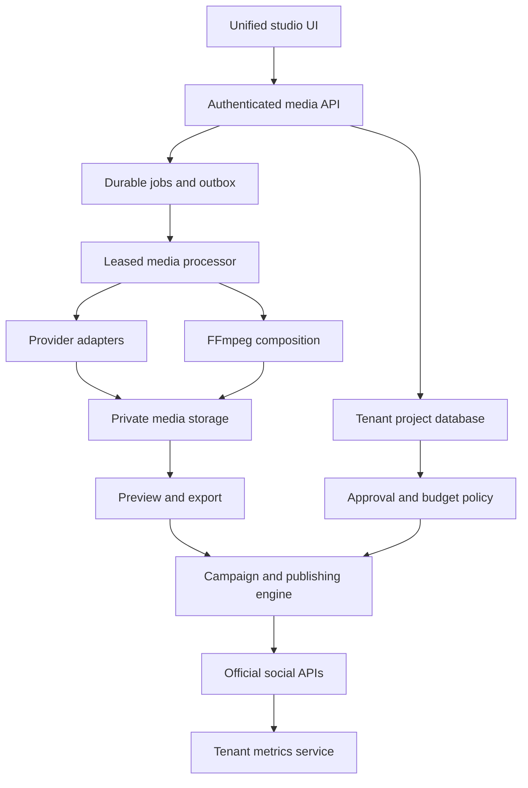

# Oprun Media Studio master blueprint — T-195

Owner approval package,21November2026. Agent: Codex. Branch: `codex/t195-media-studio-blueprint`. This is phases0–3 research/design, not a second Media Studio implementation. Application source/config/data remain unchanged.

## Evidence and authority

Read together: [recovery/audit](../media-studio/master-audit.md), [competitor research](../media-studio/master-research.md), [source census](../media-studio/master-inventory.json), [test evidence](media-studio-test-evidence.md), [decisions](media-studio-decisions.md), [journal](media-studio-progress.md), [handover](media-studio-handover.md). T193's earlier specification remains preserved at `docs/media-studio/UNIFIED_MEDIA_STUDIO_SPEC.md`; this document extends it to the owner's larger multimedia vision rather than discarding verified work.

Current production/main58fc72b, Render dep-dc0nunmc6qcc73bonn2g LIVE. T191/T192 are deployed; T193 design was never implemented. T194 remains implementation backlog. T195 stops at a concrete approval gate. Past deployment approval applied to PR166, not this transformation. No production deploy, paid provider request, new account, infrastructure purchase, destructive migration or external publication is authorized by this package.

Status: phase0 recovery VERIFIED with live-session limitations; phase1 public-source research COMPLETE; phase2 source audit COMPLETE, authenticated runtime audit PARTIAL; phase3 blueprint COMPLETE/PENDING OWNER APPROVAL. No issueB speech or issueC real generation resolution is claimed.

## Product and navigation

One **Media Studio** route under current Growth navigation. Internal views **Create**, **Projects**, **Library**, **Publish & results**. The latter deep-links the existing calendar/channel services rather than creates another scheduler. Connections and billing live in the existing settings surface with a small readiness drawer. Owner/founder authentication stays separate; no founder bypass into subscribers' media.

Full project lifecycle: Idea → AI planning → Script → Storyboard → Generation → Editing → Preview → Approval → Campaign → Publishing → Analytics → Optimization. Beginners see the next useful action rather than twelve compulsory screens. Existing footage can skip generation; no narration can skip script; no AI cost for simple uploads/editing. Each skipped step is a valid explicit mode, not a placeholder button.

### Three design directions for owner selection

| Direction | Concrete composition | Mobile behavior | Tradeoff |
|---|---|---|---|
| **A. Guided production — recommended** |Left compact project stages, central idea/prompt with visible mic/attachment/enhance, right real preview; settings drawer; scene strip appears once media exists |Single column: prompt, actions, progress, playable output; Back/Next and collapsible settings; scene/audio sheet below preview |Fastest beginner path, adds professional controls progressively; matches targeted-improvement rule |
| B. Canvas and timeline |Large preview, asset/scene rail, multi-track timeline permanently visible; inspector on selection |Preview + selectable clip rail; timeline opens as full-height edit sheet |Strong for editors, highest first-load complexity and touch-density risk |
| C. Conversation and preview |AI brief conversation left, accepted plan/cards and preview right; explicit structured settings summary before spending |Conversation then plan review and preview |Good ideation, harder precise timing/repeatability; must not hide authorization inside chat |

Recommend **A**, with B's timeline as an explicit Edit mode, and C's assistant as an optional panel. This is one interface with progressive tools, not three competing products. Owner chooses before visual-system implementation.

Style: Oprun dark navy/charcoal or light neutral surfaces, existing gold accent for primary actions, restrained cinematic preview, solid readable text, purposeful150–200ms transitions and reduced-motion support; no looping animation. Use existing design tokens/icons/components rather than new frontend framework. High contrast,44px touch controls, visible labels/focus and no icon-only mysterious actions. Controls must work in light/dark/RTL and200%zoom.

Desktop layout order: brief/Prompt+Dictate+Attach; Improve with AI; compact model/shape/quality/duration summary; Generate with budget; progress; preview; edit/export/publish. Mobile preserves this exact semantic order. No sticky UI over soft keyboard or player. Library/upload/voice are sheets sharing existing services; no duplicate asset copies or prompts. Advanced model settings show only supported values, never silent downgrades.

## Functional scope and staged delivery

| Module | Preserve now | Implement after approval | Success evidence |
|---|---|---|---|
| AI creative director |Idea/prompt, explicit enhancement |Saved script/plan, storyboard cards, scene objectives, brand context, multilingual/localized recommendations |Accepted versioned plan; originals and numeric business claims preserved; no paid render from dictation |
| Generator |Google/Runway, photo guides, camera, full duration and continuation |Capability registry, explicit reference roles, native video-to-video only when supported, scene regeneration, cost cap, cancel/resume/reconciliation |Funded minimal actual job per enabled provider; deterministic failure/interrupt coverage |
| Preview |Existing native player and full viewer |Play/pause/scrub/volume/mute/fullscreen/speed, per-scene previews, before/after versions, waveform, caption preview and signed proxy links |Actual MP4 audio/video plays on target devices; range/seek/expiry/retry tests; no fake preview |
| Voice/audio |Dictation, recorded/uploaded narration, consented clone |Actionable microphone permissions; pause where supported or segmented fallback; editable original-script STT; TTS preview; audio trim/sync/mix; licensed music, subtitles/translation |Hindi/Urdu/English real recorded samples plus supported languages; device and funded service tests distinct from mocks |
| Editing |FFmpeg concat/trim/addVoice |Time-based scene graph: drag/reorder/trim/split/merge, overlays, transitions, captions, audio tracks, logo, template, thumbnail, undo/redo, autosave and versions |Edit operations persist and produce matching preview/final output; undo never mutates original |
| Library |Private originals, upload/search/type filters, picker |Folders, tags/metadata, asset versions, usage, retention controls and intentional sharing |Two-tenant asset test; versioned derivatives; retention holds for approved campaigns |
| Campaign/publish |Existing calendars, campaign media IDs, channel adapters |One handoff/orchestrator, per-network adaptation, approvals, scheduling, processing receipt, failure and token expiry recovery |Confirmed receipts per destination; manual/export clearly distinct; no double post |
| Analytics/optimization |Existing social metrics where connected |Tenant-scoped ingest, asset/project attribution, metric freshness, goal-based suggestions and optional experiments |Provider metric provenance/timezone/time fetched; recommendations are not guaranteed outcomes |

### Provider and audio policy

Keep current Google Omni1.2Flash plus Runway alternate; Veo via a supported current route, not retired direct preview. Keep compatibility/version registry and test account entitlement. Default model is a recommendation, not a silent router. New vendor transmission, more expensive model, resolution upscale or new generation requires explicit consent within an approved cost boundary. Avatar tools and other generators remain optional extension candidates;17-provider research is not17 new integrations.

Prompt dictation is separate from narration. Give adjacent **Dictate idea/prompt**, visible Listening/Paused/Transcribing states, Stop and Cancel, original-language editable text, cursor insertion and conflict review. Auto mode must report its service readiness; failed server STT offers browser recognition only when supported and chosen. No universal-language guarantee, invented confidence or automatic translation. Evaluate independent STT using approved tenant/platform billing policy; never silently switch charging responsibility.

Full duration means a single assembled film, not one infinite native model response. Keep presets/custom seconds/minutes/voice match and explicitly budgeted ongoing generation. Long clips can incur large costs: choose final duration before estimating, show native quality versus export/upscale, warn/resolve narration timing mismatch before rendering. Already accepted vendor tasks may charge after cancellation; cancellation stops future submissions and requests upstream cancellation when supported.

## Architecture and runtime topology

Logical services are modular boundaries, not a requirement to introduce microservices immediately.

Initial reversible stage: current single Render instance, existing SQLite persistent state, one leased processor loop/child process with bounded FFmpeg concurrency1. Logical queue survives restarts in DB. Keep request handlers short: persist request and return202; existing compatibility routes can wrap this service. Don't launch CPU work for every page refresh. Use lease owner/expiry and fenced artifact writes, not just a heartbeat assumption.

Scaling stage: independently deployed workers need shared job/state storage and private object storage; propose PostgreSQL/outbox plus an approved queue/worker topology when volume justifies it. A separate Render service CANNOT share the existing web disk or its local SQLite path. Managed DB/queue/new worker costs require a concrete infrastructure decision and approval before provisioning. No silent migration of primary uploads to backup buckets.

Lifecycle required by brief: `draft → validated → cost_estimated → authorized → queued → processing → completed/failed/cancelled → stored → preview_ready`. Store outcome and output readiness separately: provider completed is not preview-ready. `needs_action` and `submission_uncertain` are recoverable states with reason. Retries operate on explicit steps; do not charge for regeneration when only assembly failed.

Submission workflow: server validates active membership/asset ownership/capability → immutable project revision → priced quote and budget reservation → idempotent job/outbox → claimed task → vendor submit → accepted task ID persisted → verified webhook or polling → constrained download → artifact validation → assembly → atomic storage/DB reference → proxy/final preview → notification. Exactly-once external billing is not guaranteed by local idempotency; uncertain acknowledgement requires reconciliation, not blind retry.

Poll safe GETs with backoff/jitter/Retry-After and bounded timeout. Paid POST retries only with documented provider idempotency or demonstrated no-acceptance. Verify webhook signature/tenant routing/replay where supported; unsigned callback is a trigger to fetch authoritative status, not proof of completion. Quotas apply per tenant, user, vendor and global service capacity. Structured logs contain trace/job IDs and sanitized error kind, no keys, bearer media URLs or unnecessary transcripts.

## Database and storage design

Extend existing tables where equivalent; new names below describe responsibilities, not approval to create duplicates. Avoid a generic new project table alongside ai_video_projects with no migration path.

| Responsibility | Existing baseline | Additive target |
|---|---|---|
| Project/version |ai_video_projects |Draft/revision, mode, plan, script, edit graph version, selected brand, target campaign; immutable studio_project_versions |
| Scenes |shots_json and ai_video_jobs seq |studio_scenes with tenant/project/revision/order, source refs, prompt/script/timing and accepted output |
| Assets |tenant_media |Parent/version, checksum, storage locator, duration/codec/proxy, processing/retention state; studio_asset_links |
| Jobs/attempts |ai_video_jobs |Idempotency key, request hash, step, quote/budget, claim fence, uncertainty, attempts/provider task IDs and artifact receipt |
| Delivery |growth_calendar/channel_drafts/campaigns |Shared publishing-attempt service behind existing entries; external receipts, content revision, signed retrieval grant |
| Authorization/cost |Existing roles/entitlements |studio_cost_quotes and studio_usage_reservations with amount/currency/price version/expiry; reconcile actual usage |
| Timeline/approval |Existing approval service |Approval binds immutable project/output/draft hash; edits invalidate approval |
| Metrics |channel_metrics/social stats |Tenant/project/asset/destination/date metric provenance and freshness; not inferred views |

Every new ownership link uses organisation_id + object ID, unique `(organisation_id,id)` targets and composite foreign keys on new tables. Existing SQLite tables may need supporting unique indexes; don't rebuild old tables to add FKs without a reviewed migration. Enforce ownership in server queries regardless. Uniques include `(organisation_id,idempotency_key)`, `(organisation_id,legacy_source,legacy_id)` and provider webhook/event dedupe. Scope queue/cache keys, tombstones, metrics and notifications to tenant. Archive by default; no cascade deleting campaign-approved media.

Object layout: server-selected tenant/project/asset/version keys; quarantine originals, derived/proxy/final artifacts distinct. URLs are not authority to modify objects. Authenticated preview uses no-store and validated range requests; server issues short-lived purpose/asset/version retrieval grants only for explicit sharing/publishing. Expiry/revocation and CDN cache TTL must agree; cannot revoke a publicly cached24h artifact instantly. Add token-version compatibility instead of invalidating existing approved links blindly. Retention cleanup honors active jobs, approvals, posts, legal holds and backup policy.

## API contracts

Reuse existing `/api/saas/ai-video` behind one domain service; expose a studio facade only where needed, no conflicting endpoints.

| Endpoint responsibility | Request/response contract |
|---|---|
| GET studio/capabilities |Model/input/quality/shape/duration/voice support; credential_valid, funding unknown/billing_required, last real success and checked_at |
| POST/PATCH studio/projects |Server tenant; input asset IDs, original/accepted prompt, script/plan, edit graph, immutable revision; optimistic expected_revision conflict409 |
| POST project/validate |Field errors, missing permissions/model limits, narration fit, storage estimate; no generation charge |
| POST project/estimate |Model/provider/output duration/price version → quote_id, currency, min/max estimate, cap and expiry; not a guarantee vendor balance sufficient |
| POST project/generate |Idempotency-Key + expected revision + accepted quote/cap →202 job_id; duplicate identical request returns same job, changed request409 |
| GET project/events or job |SSE/status with polling fallback; authoritative stage, last check, produced duration, actual/estimated charge, actionable error |
| POST job/cancel / project/finish / resume |Idempotent transitions; reservation release only when spend exposure reconciled; no repeated vendor work by default |
| POST project/preview or variants |Revision + edit graph → bounded preview/variant job; validated player metadata and signed/read-authorized endpoint |
| POST project/campaign-drafts or social-drafts |Final immutable asset IDs + destination IDs → existing service draft IDs; no publishing side effect |
| POST draft/approve / publish |Existing approval and dispatch with role/account/resource recheck, idempotency and per-destination receipt |
| GET project/metrics |Tenant-owned assets/destinations only, provenance, fetched_at and freshness state |

Error envelope: `{ok:false,error:{code,message,field?,retryable,action,trace_id},project_id?,job_id?}`. Stable codes include BILLING_REQUIRED, QUOTA_EXCEEDED, AUTH_RECONNECT, MODEL_UNAVAILABLE, INVALID_INPUT, MODERATION_REJECTED, SUBMISSION_UNCERTAIN, STORAGE_LIMIT and ASSEMBLY_FAILED. Sanitize vendor status internally; do not forward secret-bearing provider error objects.402 must preserve brief/footage and stop new submissions, not disable upload/edit/export of existing assets.

## Media editing, preview and audio pipeline

Non-destructive edit graph is canonical: source clip + in/out ms, track/order, transforms/overlays, caption cues, audio gain/fades/ducking and transition params. Validate duration bounds and integer time units. Undo/redo changes graph revision, never originals. Autosave uses debounce/revision conflict detection and clear Saving/Saved/Offline state; offline storage opt-in for private media, per-workspace partition, purge on logout/switch. Version history references immutable graph/assets.

Proxy preview uses the same composition semantics as export with lower resolution; edits do not call a generation provider. Native player is default for finished/proxy media, including play/pause, seek, volume/mute, fullscreen and speed. Scene cards play actual available files; planned storyboard cards say "not generated". Before/after is two explicit revisions with synchronized time when possible; unavailable output has Retry/Explain, not decorative play.

Audio recording selects supported MIME at runtime; test Safari MP4/AAC and Android WebM/Opus. Pause uses native support or clearly described segmented capture, stop/cancel releases tracks and invalidates late callbacks. Decode bounded audio to a waveform; trim by actual time, sample-rate normalize and mix with loudness/clipping checks. Align narration and captions to the chosen duration before cost authorization. Translation remains a reviewable caption/script derivative. Music requires upload rights or a licensed source; no arbitrary copyrighted downloads. Custom voice consent and provider verification apply; no impersonation features.

All decodes run with memory/CPU/time/pixel/frame/input-size limits, no shell interpolation, private temp paths and cleanup leases. Validate actual type rather than extension; quarantine malformed/polyglot files, reject unsupported codecs with actionable conversion options. Preserve accepted source material and avoid huge buffers in the web process. Final output must probe with expected duration, audio/video streams and checksum before setting preview_ready.

## Security threat model and two-tenant release gate

Assets to protect: originals, scripts/transcripts, voice samples, provider/social credentials, jobs, budgets, notifications, campaign drafts/receipts and metrics. Boundaries: browser↔API; tenant data↔global worker; API↔vendor; storage↔signed public grant; worker↔publisher. No client workspace_id is authorization. Founder identity cannot silently act as a subscriber.

| Threat | Required prevention and adversarial test with tenants A/B |
|---|---|
| IDOR in project/asset/voice/variant |B token submits A IDs through list/read/edit/delete/preview/export/generate;404/no metadata leaks; unchanged A artifacts |
| Job/queue forgery |Inject B org with A job/source references, stale lease and duplicate claim; worker re-fetches trusted ownership and rejects mismatches before vendor spend |
| Storage traversal/SSRF |Dot paths/symlinks, private IP/IPv6/redirect/DNS rebinding, metadata endpoints, oversized/chunked downloads; pin/validate every hop and avoid credential forwarding to arbitrary hosts |
| Credential crossover |B cannot inspect/rotate/test A provider/social keys; encrypted tenant+provider context, masked hints, no frontend/log URL secrets |
| Cross-workspace publishing |B tries A destination/token/media/approval; dispatcher rechecks current membership/resource identity immediately before send; revoked roles/access block queued work |
| Signed link misuse |Tampered tenant/asset/version/expiry/purpose, expired/revoked grant and guessed IDs fail; explicit provider grant is intentional bearer access, not a private preview bypass |
| Cache/session switch |A logout/B login cannot reuse private HTML/preview/AI responses/transcript drafts; no global unscoped cache keys or persistent captured audio |
| Notification/analytics leak |A job completion/metrics never sent to B; test recipient selection, SSE/status subscriptions and destination receipt lists |
| Unexpected charges |Duplicate click/replay, changed quote, expired quote, race/cancel and vendor timeout enforce reservations/caps; uncertain POST never auto-repeats |
| Unsafe uploads/FFmpeg |Malformed codecs, zip/polyglot, huge dimensions/duration, temp collisions and executable metadata fail safely; no shell or arbitrary file path |
| Prompt injection |Attachment/caption text cannot invoke tools, change tenant, invent offers or bypass approve/publish/budget controls |
| CSRF/webhook replay |Origin/session protections, signature verification, timestamp/event dedupe and authoritative status reconciliation |

Existing cross-tenant tests are a baseline, not complete coverage. No production release if any critical tenant test fails. Security review severity must include reproducible impact, not suppress alerts to make CI green. Public/shared STT billing/rate limits require a separate abuse review.

## Integration and analytics

Use existing channel-providers and one orchestrator under both calendar and studio handoff. Facebook/Instagram/TikTok/YouTube/X code exists but live account scopes and app reviews are unverified. LinkedIn/Pinterest require official supported adapters and permissions; export fallback until verified. WhatsApp/Snapchat Status cannot be inferred from a generic post button. Show destination capability/reason, approved immutable content, timezone and audience/privacy. Pending upload/processing is not published; only platform receipt plus final processing success is success. Reconcile uncertain sends; retry only confirmed unsent destinations.

Prepare channel variants, captions/hashtags/thumbnail/subtitle languages with user review; do not rerender master for each network unnecessarily. Token refresh/revocation handled securely per destination; a disconnected network cannot corrupt the video project. Metrics associate external post ID with exact variant and publish revision. Optimization suggests next drafts/experiments, never changes published content or initiates paid generation unapproved.

## Flags, migration, rollback and release

Proposed server-controlled tenant flags: `studio_unified_v1`, `studio_billing_recovery_v1`, `studio_edit_graph_v1`, `studio_publish_handoff_v1`. All default off until owner-approved rollout; API RBAC remains authoritative. Within a tenant only one creator is active. Legacy route/ID compatibility can redirect/import into a draft; no permanent two-system toggle.

Migration: additive schema/indexes → idempotent legacy draft mapping → validate ownership/count/hash → limited tenant flag → verify workflows → wider rollout → remove dead UI bindings only after compatibility acceptance. Preserve every old row/original/branch. Destructive data cleanup is a separate owner decision, never a prerequisite for redesign.

Rollback: tenant flag-off and previous app deployment after schema compatibility test; preserve generated files/new jobs, drain/reconcile accepted work and disable new submissions. Never restore stale DB over new customer writes. Code/runbooks for backups exist, but fresh production backup integrity/RPO and restore are not verified here. Require approved isolated staging restore and asset checksum test before release. Current previous Render deploy cfcae59 is available as a candidate, not a performed rollback proof.

## Risk register

Severity below is planning risk, not a claim a breach has occurred. No known-critical-defect clearance is issued by this documentation review.

| Risk | Priority / likelihood | Mitigation and acceptance owner |
|---|---|---|
|Cross-tenant object/worker/token/notification leakage |Critical impact, likelihood unmeasured |Principal engineer/security reviewer: two-tenant adversarial gate; any demonstrated critical leak blocks release |
|Duplicate paid submissions or uncertain publishing |High / plausible on interruption |Durable reservation, vendor task reconciliation, explicit resume, no blind POST retry; product owner accepts capped external test exposure |
|Speech device/provider mismatch |High UX / observed report |Native-device reproduction and typed STT errors before replacing controls; owner validates target device |
|Unfunded/misconfigured Google account |High availability / reported |Correct project-specific billing diagnosis, saved draft/footage, explicit compatible alternative; owner manages billing |
|Duplicate interface or incomplete edit effects |High trust / confirmed source |One flagged creator; import legacy specs as drafts; effects gated by real export acceptance |
|Worker/storage topology and resource exhaustion |High / plausible with long media |Concurrency1, bounded processing, no shared-disk assumption; DevOps approval for new topology |
|Stale/insufficient backups or incompatible rollback |High / unverified |Fresh isolated restore and additive-schema compatibility before release; DevOps records proof |
|Social app approval, scopes, token expiry and external API change |High schedule / account-dependent |Official capability checks, manual fallback, per-destination processing receipts; product owner accepts limited rollout |
|Timeline scope/cost expansion |Medium / likely if all tools built together |Small edit graph and reusable components, phased optional vendors, agreed effort/cost checkpoint |
|Browser caching/retention or bearer link over-sharing |High privacy / needs review |No-store private previews, workspace purge, versioned expiring grants and CDN TTL tests; security release gate |

## Prioritized implementation roadmap and effort

Estimates are engineering effort ranges for planning, not elapsed-time promises; real-device fixes/vendor approvals can extend them. Reuse released code; no model calls during routine unit/UI development. Work is gated by the owner's requested approvals.

| Stable batch | Scope / dependency | Effort estimate | Gate |
|---|---|---|---|
| MS-04A (T194A) |Reproduce Speak paths on actual target devices; typed provider/key402/quota recovery; actionable UI; no paid retry |2–4 engineer-days |Owner blueprint/design approval; minimal funded tests need cost authorization |
| MS-04B |Expand two-tenant tests for media/jobs/voices/previews/notifications/publishing; review shared speech billing/cache/signed links |2–4 days |Must block release on critical findings |
| MS-05A (T194B) |Direction A unified creator behind flag; one prompt/library/project list; compatibility/draft import |3–6 days |Approved visual direction and migration review |
| MS-05B |Persistent script/storyboard/versioning + genuine preview controls and autosave |4–7 days |Native playback/device acceptance |
| MS-05C |Edit graph/timeline core, trim/split/reorder, captions/text/logo, waveform/mix, undo/redo and export parity |8–15 days |Only expose verified controls; no fake edit affordances |
| MS-06A |Unify existing publishing/calendar handoff and approvals/receipts/metrics |4–8 days |Approved test destinations/content, no real posts by implication |
| MS-06B |LinkedIn/Pinterest or extra vendors, deeper analytics/optimization |3–6 days per adapter family, external approval time unknown |Explicit account/app/API access and cost decisions |
| MS-07 |Security/accessibility/performance/interrupt/isolation regression, independent review where available |3–5 days |Zero known critical defects, all mandatory gates pass |
| MS-08 |Backup restore evidence, rollback rehearsal, release notes, approved exact commit |1–2 days |Separate production deployment approval |
| MS-09 |Live commit/UI/voice/preview/provider/publishing/isolation verification |1–2 days |Controlled spend and approved test accounts/content |

Core transformation roughly5–10 engineering weeks depending on scope/concurrency/device access; optional integrations and external reviews excluded. Can release smaller coherent, independently accepted batches with explicit release approval. No need to build a new frontend framework, add17 vendors, or provision new services at the start.

Performance acceptance targets (proposed, measure on representative agreed device/network): creator usable within3sec p75 on4G simulation; no unrelated heavy editor load until Edit; cached local UI interactions<100ms excluding vendor work; video starts within3sec for a small proxy on agreed4G; no sidebar overflow360px; no control blocked at200%zoom; concurrency1 on present512MB service until measured. These are targets, not current results. Track LCP/INP, memory, decode/render durations and vendor latency separately.

## Approval requested

Approve **Direction A**, the one-project architecture and staged MS-04A → MS-04B → MS-05A implementation. This authorizes targeted code changes and mocked/isolated tests only, not production deployment, destructive changes, new infrastructure/subscriptions, paid real-provider calls or social publication. Specify a spending ceiling and approved test account/content separately when funded external acceptance is ready. Alternative visual directions B/C can be chosen before implementation.

Do not ask for deployment approval until a concrete tested candidate, rollback plan and unresolved limitations are reviewable. Do not claim mathematically zero bugs or automatic session resumption. Current objective: zero known critical release defects with evidenced core workflows and uncompromising tenant isolation.
